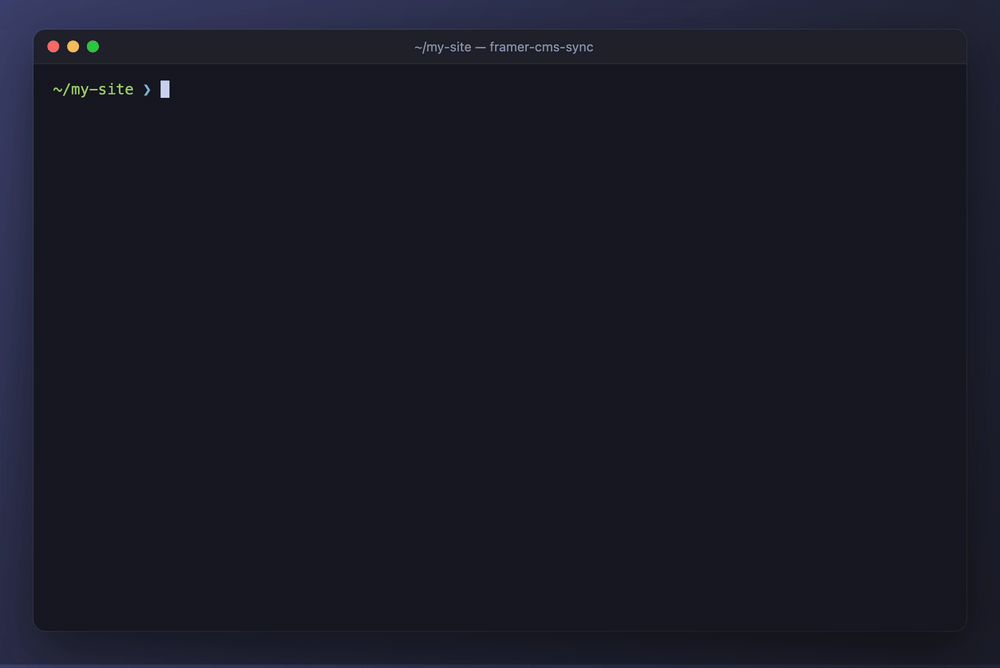

# framer-cms-sync: sync CSV, JSON, Markdown and databases to Framer CMS

**Keep your Framer site's CMS up to date from your own data, without opening Framer. Import a CSV, publish a Markdown blog, sync a database, automate it with n8n, or let an AI agent do it for you.**

[](https://www.npmjs.com/package/framer-cms-sync)
[](LICENSE)
[](https://nodejs.org)
[](#mcp-server-for-ai-agents)

framer-cms-sync is an open-source **Framer CMS sync tool** built on Framer's official [Server API](https://www.framer.com/developers/server-api-introduction). It copies data from a spreadsheet, a database, a folder of Markdown files or any URL into **Framer CMS collections**. It shows you exactly what will change before anything is written, and publishes your site only when you ask.

Use it as a **terminal app**, a **command-line tool (CLI)**, a **self-hosted HTTP API and Docker container** (for n8n, Make, Zapier, cron and webhooks), an **MCP server** (for Claude, Cursor and other AI agents), or a **Node.js library**.



> Not an official Framer product. framer-cms-sync is an independent open-source project that uses Framer's public Server API. "Framer" is a trademark of Framer B.V.

---

## Contents

- [Features](#features)
- [What you can use it for](#what-you-can-use-it-for)
- [Try it without a Framer account](#try-it-without-a-framer-account)
- [Quick start](#quick-start)
- [How it works](#how-it-works)
- [Choosing what an apply does](#choosing-what-an-apply-does)
- [Managed vs unmanaged Framer collections](#managed-vs-unmanaged-framer-collections)
- [Configuration](#configuration)
- [Inspect your data first](#inspect-your-data-first)
- [Field mapping](#field-mapping)
- [Multiple Framer sites](#multiple-framer-sites)
- [Terminal app](#terminal-app)
- [Command line (CLI)](#command-line-cli)
- [HTTP API and Docker](#http-api-and-docker)
- [Access tokens](#access-tokens)
- [MCP server for AI agents](#mcp-server-for-ai-agents)
- [Automate Framer CMS with n8n](#automate-framer-cms-with-n8n)
- [Node.js library](#nodejs-library)
- [Safety](#safety)
- [FAQ](#faq)
- [Limitations](#limitations)
- [Guides for people and agents](#guides-for-people-and-agents)
- [Contributing](#contributing)
- [License](#license)

---

## Features

- **Import Excel, CSV, Google Sheets, JSON or Markdown into Framer CMS**, from a file, a folder, a shared sheet or a URL. Database rows can be sent directly from n8n, a script or an agent.
- **Start in sync:** download every item of an existing collection into Excel, CSV or Markdown (with rich text converted back to Markdown), edit it there, and sync it back. Or start a new collection from a template file.
- **Preview before you write.** Every sync shows what would be created, updated and removed, with old → new values, before anything changes.
- **Problems come with fixes.** Bad prices, missing titles, broken image paths and unknown dropdown options are caught before writing, and each one says how to fix it.
- **Works with every kind of collection**: collections you built by hand in Framer, collections the tool creates for you, and a managed copy of collections locked by another plugin.
- **Creates collections for you**, with fields worked out from your data (text, numbers, dates, yes/no, images, links, rich text) or copied from an existing collection.
- **Markdown blog to Framer**: frontmatter fills the fields (title, date, author, cover image, SEO description), and the body becomes rich text, with lint checks for broken links and images.
- **Publish when you choose**: never, every time, or only when something actually changed.
- **Removes what's gone from your data**, behind three safety guards so a broken export can't wipe a collection.
- **Bulk redirects**: import hundreds of redirects from a CSV, with checks for redirect chains and redirects that would hide a live page.
- **Multiple Framer sites** from one setup, each with its own API key.
- **Built for AI agents**: an MCP server, previews an agent can't skip, scoped tokens, and machine-readable errors with fixes.
- **Self-hosted**: runs on your laptop, a server, in Docker or in CI. Your data only goes to Framer.

## What you can use it for

### Import a CSV or Google Sheets export into Framer CMS

Keep prices, products, team members, locations or job listings in a spreadsheet. Export it as CSV (or point the tool at a published CSV link) and sync it into a Framer collection. Edit the sheet, sync again, and only the changed items are updated.

### Publish a Markdown blog to Framer

Write posts in Obsidian, VS Code or any editor, and keep them in a folder or a Git repo. One command publishes the whole folder, and `add`, `update` and `remove` handle a single post straight away. Frontmatter maps to your collection's fields automatically, and posts you delete locally can be removed from Framer too.

### Sync a database to Framer CMS (Postgres, Supabase, Airtable, Notion)

Query your database in n8n, Make, a script or a scheduled job, and send the rows to the HTTP API. Each row becomes a CMS item, matched by a key column, so repeat syncs update rather than duplicate.

### Automate Framer CMS updates

Run a sync on a schedule with cron, GitHub Actions, n8n or Make. With `publish: on-change`, the site is only republished when something actually changed.

### Let an AI agent manage your Framer CMS

Connect Claude, Cursor or any MCP-capable agent. Ask for "a post comparing eSIMs for Japan, published", or "raise all Pro prices by 10%", and the agent writes the content, previews it, fixes what the preview flags, applies and publishes. Scoped tokens decide what it may do.

### Bulk import redirects into Framer

Import a `from,to` CSV of old and new URLs. The tool catches redirect chains, duplicates and redirects that would hide a live page before anything is saved. When you delete a page, it can redirect the old URL in the same step.

## Try it without a Framer account

```bash
git clone https://github.com/Nikto655/framer-cms-sync.git
cd framer-cms-sync
npm install && npm run build
npm run demo
```

`npm run demo` opens the terminal app on [`examples/demo`](examples/demo), with a JSON file standing in for a Framer project. Try `npm run demo -- plan pricing` for the command-line version.

## Quick start

**You need:** Node.js 22 or newer, a Framer project, and a Framer API key.

1. **Create an API key in Framer:** open your project, then **Site Settings → API**, and create a key.
2. **Copy your project URL** from the browser's address bar in the Framer editor. It looks like `https://framer.com/projects/My-Site--abc123` (the editor address, not your live site).
3. **Run the setup** in the folder that holds your data:

   ```bash
   npx framer-cms-sync
   ```

   The terminal app walks you through it, step by step:

   1. **Site:** your project URL, API key and a short name.
   2. **Collection:** create a new one (managed or regular), or pick an existing one: take over a hand-built collection, or copy one owned by another plugin.
   3. **Data source:** an Excel/CSV file, a folder of Markdown files, a Google Sheet, an endpoint (URL), or nothing: a pass-through sync where agents, the HTTP API or single commands send the data and nothing is stored locally.
   4. **Connect:** point it at your file, folder, sheet or URL. For an existing collection you can **download every current item** into a new Excel, CSV or Markdown file, so your file and the CMS start out identical. For a new collection you can start from a **template file**.
   5. **Review:** see exactly what will happen, then confirm.

   You land on a preview of the first sync. Press `a`, choose what to apply (only add new, only update existing, add and update, or replace all), then whether to publish.

Prefer commands?

```bash
npx framer-cms-sync init --name mysite --url https://framer.com/projects/My-Site--abc123 --key <API key>
npx framer-cms-sync collections          # what's there, and what the tool can write to
# add a sync to framer-cms-sync.config.yaml (see Configuration), then:
npx framer-cms-sync plan pricing         # preview: writes nothing
npx framer-cms-sync apply pricing        # write to the CMS
npx framer-cms-sync apply pricing --publish
```

Your URL and key are saved in `.env` (git-ignored). The config file only refers to them, so it's safe to commit.

## How it works

```
 your data                   framer-cms-sync                          Framer
 ─────────                   ───────────────                          ──────
 CSV / JSON file   ──►  read → match columns to fields      ──►   CMS collection
 Markdown folder        → check for problems → compare           (and your live site,
 URL / database         with Framer → preview → write             only when you ask)
                        → publish (if asked)
```

A **sync** is one saved link between a source of data and one Framer collection, defined in `framer-cms-sync.config.yaml`. Every sync can be:

- **planned**: a dry run that lists what would be created, updated and removed, and any problems with fixes. It writes nothing.
- **applied**: does exactly what the plan showed, using the same code, so the preview never lies. If any record has an error, nothing is written.

Items are matched to your data by a key column (like `Name` or `Title`), which also becomes each page's URL slug: "Pro Monthly" becomes `/pro-monthly`. A column missing from your data leaves that field alone in Framer, while an empty value clears it.

### Choosing what an apply does

Every item is matched by its **slug**, just as in Framer. After a preview you choose what to apply:

| Choice | What it does | CLI / HTTP / MCP |
|---|---|---|
| **Only add new** | Adds new slugs; existing items are untouched | `--create-only` · `createOnly=true` |
| **Only update existing** | Updates changed items; new slugs are left out | `--update-only` · `updateOnly=true` |
| **Add new and update changed** | Adds items whose slug isn't in Framer yet, updates items that changed; removes nothing | `--partial` · `partial=true` |
| **Replace all** | Makes the collection match your data: adds, updates, and **removes items whose slug isn't in your data** | `--replace` · `replace=true` |

Then you choose whether to **publish** (the terminal app asks; elsewhere `--publish` / `publish=true`). Every preview also lists items that are in Framer but not in your data, so you can see what "replace all" would remove. Replace all needs your whole data set, and a large removal asks for explicit confirmation (`--allow-mass-remove`).

Unchanged items are never rewritten: text, numbers, dates, options, yes/no, image URLs and rich text are all compared. Rich text is compared by content, so formatting Framer adds when storing it doesn't count as a change.

```bash
framer-cms-sync apply blog ./posts/new-post.md          # one post; other posts untouched
framer-cms-sync apply products ./new-rows.csv --create-only
framer-cms-sync apply products --replace --publish
```

Data sent to the HTTP API or MCP counts as **partial** (add and update) unless you say `complete=true` or `replace=true`.

## Managed vs unmanaged Framer collections

Framer's API treats collections differently depending on who owns them. This is the most important thing to know about writing to the Framer CMS, and the tool handles it for you:

| Collection | What the tool can do |
|---|---|
| **Built by hand in Framer** (unmanaged) | Fills it directly, with no setup and no template changes. Your team can still edit items in Framer, and fields your data doesn't include are left alone. |
| **Created by framer-cms-sync** (managed) | Full control, including fields. Your data is the single source of truth. |
| **Owned by another plugin** | Framer refuses all writes from anyone else, and ownership can't be transferred. The tool creates **your own managed copy** with the same fields; you switch your page template to it once in the Framer editor. |

By default (`mode: auto`) the tool detects which kind you have, and `framer-cms-sync collections` explains each one in plain words.

**Starting from nothing?** The tool can create the collection, either kind. Choose **managed** when your data lives elsewhere (prices, listings, anything generated), or **regular** when your team also edits items in Framer (blogs, mixed content). Fields are worked out from your data or copied from another collection:

```yaml
syncs:
  team:
    collection: { name: Team, create: true, mode: managed }   # or mode: unmanaged
    source: { type: csv, path: ./team.csv }
    key: { field: Name }
    # schemaFrom: Pricing    # copy fields from an existing collection instead
```

Then run `npx framer-cms-sync setup team`.

Other Framer details handled for you:
- Item ids are capped at 64 characters, so long slugs get a stable hashed id.
- Number fields can't be empty, so empty values are skipped with a warning.
- Drafts you set by hand are kept.
- Publishing ships the **whole site** as it is, not just the CMS change, and the tool reminds you.

## Configuration

Everything lives in `framer-cms-sync.config.yaml`. `${VAR}` and `${VAR:-default}` read from `.env` or the environment.

```yaml
projects:
  mysite:
    url: ${FRAMER_PROJECT_URL}
    apiKey: ${FRAMER_API_KEY}
    label: My Site                     # display name (optional)

defaults:
  publish: never                       # never | always | on-change
  deploy: true                         # after publishing, promote the preview to production

syncs:
  pricing:
    collection: { name: Pricing }      # or { id: … }; mode: auto | managed | unmanaged
    source: { type: csv, path: ./pricing.csv }    # json | csv | markdown; path or url (+ headers)
    key: { field: Plan Name }          # identifies each row; becomes the URL slug
    fields:
      map: { "Price": "Monthly Price" }   # column → field name, when names differ
      ignore: [Internal notes]
      unknown: warn                    # columns with no matching field: warn | error | ignore
      nulls: clear                     # empty values clear the field (clear) or keep Framer's (skip)
    prune: { minItems: 10, maxRemove: "20%" }     # remove items missing from the data (default: off)
    publish: on-change

  blog:
    collection: { name: Blog }
    source: { type: markdown, path: ./posts }
    path: /blog/                       # page URL prefix, used for redirects
    lint:
      max-length: { level: warn, meta_description: 160 }

server:
  tokens:
    - { name: agent, token: "${AGENT_TOKEN}", scope: write }    # read | write | publish | admin

plugins: [./my-rules.js]               # optional custom lint rules and transforms
```

### Excel, Google Sheets and downloads

- **Where files go:** New syncs keep their files in one folder per site: `data/<site>/<sync>.xlsx` (or `.csv`), and a folder of posts at `data/<site>/<sync>/` for Markdown. Any other path works too; it's just the wizard's default.
- **Excel:** `source: { type: excel, path: ./data/products.xlsx, sheet: Prices }` (the first sheet if `sheet` isn't set). Dates, links and formulas come through as their values.
- **Dates like 10/08/2026** can mean 10 August or October 8, so the tool never guesses. If your data makes the order clear (a value like 25/08), it's used; otherwise set `fields.dateOrder: DMY` (day first) or `MDY` (month first). The setup wizard asks once, using a date from your data as the example. Ambiguous dates are refused until it's set.
- **Google Sheets:** `source: { type: csv, url: <the sheet's normal link> }`. The tab in the link is the one that's read, and the sheet must be shared as "Anyone with the link → Viewer". The tool reads Sheets but can't write to them, so to start a Sheet from your CMS, download a CSV and use **File → Import** in Google Sheets.
- **Download** a collection to start in sync, or write a **template**:

  ```bash
  framer-cms-sync download Products ./data/products.xlsx     # also .csv, .json, or a folder for Markdown
  framer-cms-sync template ./data/new.xlsx --from Products   # columns copied from a collection
  ```

- **Bring Framer edits back into your file:** if items were edited in Framer, `framer-cms-sync pull <sync>` (or Settings → Download from Framer in the terminal app) replaces the sync's file or folder with everything currently in Framer, in the same format. The previous version is saved next to it first (`….before-download-<date>…`), and the sync's key is set to the exact slugs, so the next preview shows no changes. Syncing itself only ever goes from your file into Framer; this is the one way back. It isn't available for Google Sheets or endpoint sources.

  Downloads include a `slug` column (`slug:` in Markdown), so a sync pointed at the file matches every existing item: the first preview shows no changes. Both commands print the `source:` and `key:` lines to use.

### Inspect your data first

Not sure what an endpoint or file returns? `inspect` shows its format, where the records are, and every field with its type and sample values, before you set up a sync:

```bash
framer-cms-sync inspect https://api.example.com/plans
framer-cms-sync inspect ./products.csv
framer-cms-sync inspect ./posts                  # a folder of Markdown posts
framer-cms-sync inspect pricing                  # an existing sync's source
framer-cms-sync inspect https://api.example.com/plans --header "Authorization: Bearer …"
```

URLs are fetched live with a single GET request, and nothing is stored. It ends with a ready-to-paste `source:` line and a suggested key column. For data that's sent in rather than fetched (n8n posting rows, an agent passing records), send the same data to `POST /inspect` or the `inspect_source` MCP tool.

**Nested JSON.** Many APIs wrap their records (`{ "data": { "items": [...] } }`) and nest values (`"price": { "amount": 21 }`). Tell the sync where the records are with `rows`. Nested values arrive as dotted names you can map like any column:

```yaml
source: { type: json, url: https://api.example.com/plans, rows: data.items }
fields:
  map: { "price.amount": "Price" }
```

If the records aren't where expected, the error names the likely path ("set source.rows: data.items").

### Field mapping

Each column in your data (CSV header, JSON key or Markdown frontmatter) is sent to one collection field. Columns are matched automatically, in this order:
1. Your explicit mapping.
2. For Markdown, built-in standard names (`date` → "Publish Date", `meta_description` → "Meta Description", `content` → the body field).
3. The same name.
4. A similar name that ignores case and punctuation.

When a column doesn't match, the preview warns you and says what to add. Mappings live in the config, so a person or an agent can change them there:

```yaml
syncs:
  products:
    fields:
      map: { "Price (USD)": "Price" }    # your column → the field's name
      ignore: [Internal notes]           # never sent, never warned about
```

Or without editing the file:

- **CLI:**

  ```bash
  framer-cms-sync map products                          # view
  framer-cms-sync map products "Price (USD)" "Price"    # send a column to a field
  framer-cms-sync map products "Internal notes" --ignore
  framer-cms-sync map products "Price (USD)" --auto     # back to automatic
  ```

- **HTTP:** `GET /syncs/:sync/mappings` to view, `POST /syncs/:sync/mappings` with `{ "changes": [{ "column": "Price (USD)", "to": "Price" }] }` to change. `to` is a field name, `"ignore"` or `"auto"`.
- **MCP:** `get_mappings` and `set_mappings`, so an agent can fix an unmatched column it sees in a preview.

Changes are saved to the config as `fields.map` and `fields.ignore`, which you can also edit by hand. The view flags columns that match nothing, columns that match several fields, two columns filling the same field, mappings to fields that no longer exist, and fields nothing writes to.

**Markdown posts:** YAML frontmatter plus a body, rendered to HTML (tables, raw HTML and embeds pass through). A leading `# Title` is dropped because your template shows the title. The slug comes from `slug:` or the filename, and `published: false` makes a draft. Built-in lint rules: `no-wikilinks`, `absolute-images` (errors), `no-placeholders` (warning), plus opt-in `max-length`, `required` and `no-em-dash`.

**Plugins** add lint rules and record transforms:

```js
export default {
  lintRules: { "no-lorem": ({ body }) => (/lorem ipsum/i.test(body) ? "placeholder text left in" : null) },
  transforms: { pricesToNumbers: (r) => ({ ...r, Price: String(r.Price).replace(/[^0-9.]/g, "") }) },
};
```

Use a transform with `syncs.<name>.transform: pricesToNumbers`.

## Multiple Framer sites

Manage several Framer projects from one setup. Each site has a short name, its own URL and API key, an optional display name and colour, and its own syncs:

```yaml
projects:
  main: { url: ${FRAMER_MAIN_URL}, apiKey: ${FRAMER_MAIN_API_KEY}, label: Main Site }
  shop: { url: ${FRAMER_SHOP_URL}, apiKey: ${FRAMER_SHOP_API_KEY}, label: Shop, color: magenta }

syncs:
  blog:     { project: main, collection: { name: Blog }, source: { type: markdown, path: ./posts } }
  products: { project: shop, collection: { name: Products }, source: { type: csv, path: ./products.csv }, key: { field: Name } }
```

One site is **current**: new syncs, collections, redirects and publishing use it.
- **Terminal app:** press **Tab** to switch, or **w** for the Sites screen (switch, rename, change display name, check connections, add or remove sites).
- **CLI:**

  ```bash
  framer-cms-sync projects                    # list sites; • marks the current one
  framer-cms-sync projects use shop           # switch
  framer-cms-sync projects rename shop store  # syncs follow the new name
  framer-cms-sync projects label store "My Shop"
  framer-cms-sync init --name blog2 --url … --key …    # add a site
  ```

**Deleting** a sync (Settings → Delete this sync, or `framer-cms-sync syncs remove <name>`) or a site (Sites screen → `x`, or `framer-cms-sync projects remove <name> --with-syncs`) removes it from framer-cms-sync:
- its settings, secrets saved in `.env` (URL, API key, source tokens), and access tokens limited to it
- for a site, all its syncs too
- deleting your only site resets the app to first-time setup

**Framer is never changed.** You're asked whether to keep the source files (the default) or delete them too (`--delete-files`); only files inside the project folder are ever deleted.

Every confirmation that writes, publishes or deletes names the site. `--project` (CLI), `?project=` (HTTP) and `project` (MCP) always override the current site, and automations never rely on it.

## Terminal app

Run `npx framer-cms-sync` in a terminal. The app includes:
- Guided setup, with an explanation at every step.
- A new-sync wizard: fill an existing collection or create a new one, from a spreadsheet, a Markdown folder, a Google Sheet, an endpoint, or nothing (pass-through for agents and apps).
- A home screen of your syncs, per site.
- Previews that show every change, then let you choose what to apply and whether to publish. Unmanaged collections warn before replacing edits made in Framer.
- Settings: change sources, collections and key columns, download from Framer, or delete a sync.
- Sites, access tokens, redirects, collections and run history screens.

Every action shows the equivalent command, so you learn the CLI as you go.

## Command line (CLI)

| Command | What it does |
|---|---|
| `init`, `collections`, `fields <collection>`, `syncs` | set up and look around |
| `inspect <url \| file \| folder \| sync> [--rows path] [--header "K: V"]` | see what data looks like before syncing it |
| `projects`, `projects use / rename / label / remove` | list, switch and name sites |
| `setup <sync> [--force]` | create the collection with fields from your data or `schemaFrom` |
| `check <sync>` | compare your data with the collection's fields |
| `plan <sync> [input…]` | preview: input is files, folders, globs or `-` for stdin |
| `apply <sync> [input…]` | write: `--publish`, `--publish-on-change`, `--no-deploy`, `--plan-id`, `--limit`, `--only`, `--allow-mass-remove` |
| `items <sync>`, `remove <sync> <slug> [--redirect-to slug] [--keep-file]` | list and delete items (and a Markdown post's file) |
| `add <sync> <post.md…>`, `update <sync> <post.md…>` | add or update single Markdown posts straight away, keeping the folder in step |
| `map <sync> [column] [field \| --ignore \| --auto]` | view or change which column goes to which field |
| `redirects list / plan <csv> / apply <csv> / remove <from…>` | bulk redirects |
| `publish`, `history`, `describe` | publish a site, recent runs, reference for agents |
| `serve`, `mcp` | run the HTTP API or the MCP server |

Output is JSON when piped (or with `--json`). Exit codes: `0` ok, `1` validation failed, `2` refused by a safety guard, `3` config or auth, `4` Framer or source error.

Every command and option, with examples: [`skills/framer-cms-sync-cli/references/commands.md`](skills/framer-cms-sync-cli/references/commands.md), or `framer-cms-sync skills cli commands` in a terminal.

## HTTP API and Docker

Run framer-cms-sync as a self-hosted service that n8n, Make, Zapier, cron, CI or your own apps can call.

```bash
npx framer-cms-sync serve        # http://127.0.0.1:8080
```

**Docker:** put your config and `.env` in a folder and mount it at `/config`:

```bash
docker build -t framer-cms-sync .
docker run --rm -v "$PWD/my-site:/config" framer-cms-sync \
  node /app/dist/cli/index.js init --name mysite --url https://framer.com/projects/… --key-env FRAMER_API_KEY
docker compose -f examples/docker-compose.yml up -d     # HTTP API + MCP on 127.0.0.1:8080
```

**The terminal app runs inside the container too**, which is the easiest way to set up and manage a server:

```bash
docker run -d --name framer-cms-sync -v "$PWD/my-site:/config" -p 127.0.0.1:8080:8080 framer-cms-sync
docker exec -it framer-cms-sync sh                   # opens the terminal app straight away (also Docker Desktop's Exec tab)
                                                     # q leaves the app for the shell; FRAMER_CMS_SYNC_NO_TUI=1 skips it
```

On a fresh, empty folder the service starts in **setup mode**: `/health` and the logs explain what to do, and other routes answer `503`. As soon as setup has added a site and an access token, it starts serving, with no restart. Changes made in the app (new syncs, tokens, sites) are picked up by the running service immediately.

The container runs as a non-root user, has a health check, and keeps its config, `.env`, run log and state in the mounted folder. `--key-env` reads the key from `/config/.env`, so it never lands in your shell history.

Authenticate with `x-sync-token: <token>` (or `Authorization: Bearer <token>`). Bodies can be:
- **JSON:** an array of records, or `{ rows: [...] }`. n8n items are unwrapped automatically.
- **CSV** text.
- **Markdown:** `{ posts: [{ slug, markdown }] }`.

An empty body uses the sync's configured source.

For a Markdown sync, `POST /syncs/<sync>/items` adds a post and `PUT /syncs/<sync>/items` updates one, straight away. The body is Markdown text (`?slug=`) or `{ slug, markdown }`. `DELETE /syncs/<sync>/items/<slug>` removes one. The sync's folder is kept in step.

Data in the body is **partial** by default: it adds and updates but never removes. Add `?complete=true` when you're sending the full data set and want items missing from it removed, or `?createOnly=true` to only add new items. With an empty body the sync's own source is used, which counts as complete (`?partial=true` to never remove).

| Route | Token scope |
|---|---|
| `GET /health` | none |
| `POST /mcp` | MCP over HTTP (tools follow the token's scope) |
| `GET /projects`, `GET /collections?project=`, `GET /syncs` | read |
| `POST /syncs/:sync/plan`, `GET /syncs/:sync/check`, `GET /syncs/:sync/items`, `GET /syncs/:sync/mappings` | read |
| `POST /syncs/:sync/mappings` | write |
| `GET /syncs/:sync/inspect` (its source, fetched live), `POST /syncs/:sync/inspect` or `POST /inspect` (data in the body) | read |
| `POST /inspect?url=…` (any URL) | admin, because fetching arbitrary addresses could reach your internal network |
| `POST /syncs/:sync/apply?publish=&planId=&complete=&createOnly=&limit=&only=` | write (publish to publish) |
| `DELETE /syncs/:sync/items/:slug?redirectTo=` | write |
| `GET /redirects`, `POST /redirects/plan` · `POST /redirects/apply` | read · write |
| `POST /publish?project=&deploy=false` | publish |
| `POST /syncs/:sync/setup` | admin |

Tokens can be limited to certain sites or syncs. The example Docker setup listens on localhost only, because Docker's port publishing bypasses host firewalls.

## Access tokens

Anything that uses framer-cms-sync over the network (an AI agent over MCP, an n8n workflow, a script, CI) needs an **access token**. Tokens are separate from your Framer API key: the key lets framer-cms-sync talk to Framer and is never shared, while a token lets something else use framer-cms-sync, only as far as its **scope** allows.

| Scope | Allows |
|---|---|
| `read` | look at collections and syncs, preview changes; never writes |
| `write` | preview and write changes, delete items; can't publish |
| `publish` | everything `write` can do, plus publish the site |
| `admin` | everything, including creating collections and overriding safety limits |

Create one token per use, so you can revoke one without touching the others. Tokens can also be limited to certain sites or syncs. Limited tokens work with the HTTP API but not with MCP.

**Terminal app:** press **t** for the Tokens screen. Pick what will use the token (AI agent, automation that writes, automation that publishes, read-only, admin), name it, and optionally limit it. The token is shown **once**, together with ready-to-copy MCP config, a curl test and n8n settings. Revoke a token with **x**.

**CLI:**

```bash
framer-cms-sync tokens                                   # list (never shows values)
framer-cms-sync tokens add claude --scope write --description "Claude on my laptop"
framer-cms-sync tokens add n8n-pricing --scope publish --syncs pricing
framer-cms-sync tokens revoke claude
```

Token values are stored in `.env` (`SYNC_TOKEN_<NAME>`) and referenced from the config. A running server picks up added and revoked tokens immediately, with no restart. Agents started locally over stdio don't need a token; their access is set with `--scope`.

## MCP server for AI agents

framer-cms-sync includes a **Model Context Protocol (MCP) server**, so Claude, Cursor, Claude Code and other MCP clients can manage your Framer CMS directly.

**Local (stdio):**

```json
{ "mcpServers": { "framer-cms-sync": { "command": "npx", "args": ["-y", "framer-cms-sync", "mcp", "--scope", "write", "--config", "/path/to/framer-cms-sync.config.yaml"] } } }
```

**Remote (HTTP), e.g. the Docker container:**

```json
{ "mcpServers": { "framer-cms-sync": { "type": "http", "url": "http://127.0.0.1:8080/mcp", "headers": { "x-sync-token": "<agent token>" } } } }
```

**Tools:**
- **Always available:** `list_projects`, `list_collections`, `get_fields`, `list_syncs`, `check_sync`, `inspect_source` (any URL with admin scope only), `get_mappings`, `list_items`, `plan_sync`, `plan_redirects`, `describe`.
- **With write scope:** `apply_sync`, `set_mappings`, `remove_item`, `apply_redirects`.
- **With publish scope:** `publish_site`.
- **With admin scope:** `setup_collection`.

**Why it's safe to give to an agent:**
- `apply_sync` needs the `planId` from a fresh `plan_sync`, so an agent can't skip the preview.
- Publishing is a separate tool you can withhold.
- Removals have hard limits.
- Every problem has a stable code and a plain-words fix, so agents can correct their own mistakes.

The [`skills/`](skills) folder has Agent Skills covering every part of the tool (copy them into `.claude/skills/`), and [`agents/`](agents) has an `AGENTS.md` snippet and MCP config examples.

## Automate Framer CMS with n8n

[`examples/n8n`](examples/n8n) has two importable workflows:
- **Scheduled sync:** query your database (or any n8n source), send the rows to framer-cms-sync, and publish only when something changed. It includes a safe "preview" button.
- **Webhook proxy:** lets a laptop, script or agent push Markdown posts and redirects through n8n to a private framer-cms-sync container.

The same pattern works with Make, Zapier, GitHub Actions or a cron job: send the rows to `POST /syncs/<name>/apply`.

## Node.js library

```bash
npm install framer-cms-sync
```

```ts
import { createSync, loadConfig } from "framer-cms-sync";

const { config, dir, file } = loadConfig();
const sync = createSync({ config, configDir: dir, configFile: file });

const plan = await sync.plan("pricing", { records: rows });
if (plan.ok) {
  await sync.apply("pricing", { records: rows }, { planId: plan.planId, publish: "on-change" });
}
```

## Safety

- **Nothing goes live by accident.** Publishing defaults to `never` and is always a separate, explicit step.
- **Removals are guarded three ways:**
  - Only when the input is your complete data set: never for a single post, data sent over HTTP or MCP (unless it says `complete`), `--partial`, `--create-only`, `--limit` or `--only`.
  - Only when the source has at least `prune.minItems` records.
  - Never more than `prune.maxRemove` (default 20%) in one run without an explicit override.
- **Fields aren't overwritten:** `setup` never replaces existing fields without `--force`.
- **Locked down by default:** the server won't start without a token, and tokens are scoped (read, write, publish, admin).
- **Secrets stay secret:** API keys live in `.env` and are scrubbed from errors and logs.
- **Everything is logged:** every write is recorded in a local run log, whether a person or an agent ran it.

## FAQ

### How do I import a CSV into Framer CMS?
Run `npx framer-cms-sync`, choose your collection (or create one), give it the CSV file, and pick the column that identifies each row. Review the preview, press `a` and choose what to apply. To repeat it later, run `framer-cms-sync apply <sync>`; only changed rows are updated.

### Does Framer have a CMS API?
Yes. Framer's [Server API](https://www.framer.com/developers/server-api-introduction) (in open beta) lets scripts read and write CMS collections and publish sites without opening Framer. framer-cms-sync is built on it and adds previews, field mapping, safety guards and the interfaces above.

### Can I update Framer CMS automatically on a schedule?
Yes. Run `framer-cms-sync apply <sync>` from cron or GitHub Actions, or use the HTTP API from n8n or Make. Set `publish: on-change` to republish only when something changed.

### Can I publish a Markdown blog to Framer?
Yes. Point a sync at a folder of `.md` files. Frontmatter fills your fields and the body becomes rich text. Add or update one post with `add blog ./my-post.md` or `update blog ./posts/my-post.md`, or sync the whole folder with `apply blog`.

### Why can't I write to a collection created by another plugin?
Framer only lets the plugin or connection that owns a managed collection change it. The tool detects this and offers to create your own copy with the same fields. You then switch your page template to the copy once in the Framer editor.

### Does it work with Google Sheets, Airtable, Notion or Supabase?
Yes, through CSV or JSON. Export or publish a sheet as CSV, point a sync at a URL that returns JSON or CSV, or query the source in n8n, Make or a script and send the rows to the HTTP API.

### Will it change my live site?
Not unless you ask. Applying changes writes to the CMS only. Your live site updates when you publish, which is always a separate, explicit step.

### Can an AI agent use it?
Yes. It includes an MCP server for Claude, Cursor and other agents, plus scoped tokens so you decide whether an agent can only preview, write, or also publish.

### Can I manage more than one Framer site?
Yes. Add sites with `framer-cms-sync init --name …` or from the terminal app, and switch between them with Tab.

### Is it free?
framer-cms-sync is free and open source (MIT). Framer's Server API is free during its open beta, and your Framer plan's own limits still apply.

### Is this an official Framer tool?
No. It's an independent open-source project built on Framer's public API.

## Limitations

- **CMS content and redirects only.** It doesn't design or edit pages.
- **One way:** changes flow from your source to Framer. Edits made in Framer only come back when you pull them into your file (`pull`, or Settings → Download from Framer).
- **No built-in scheduler.** Use cron, CI, n8n or an agent.
- **Images must be public URLs.** Framer copies them in; local image upload isn't supported yet.
- **Can't delete collections.** Framer's API has no documented way to, so remove them in the editor.
- **Redirects need a Framer plan that includes them.**
- **One process per project.** Writes are queued within a process; don't run several instances writing to the same project at once.
- **Early release (0.x)** on a beta API. It's tested against a real Framer project and an in-memory model of the API, but try it on a copy of your project first.

## Guides for people and agents

The [`skills/`](skills) folder holds the full documentation, one topic per folder. Each topic has a `SKILL.md` with longer detail in `references/`, so people can read them here on GitHub.

They're also written as [Agent Skills](https://agentskills.io), an open format that AI coding agents such as Claude Code and Cursor understand. Copy the folders into your agent's skills folder (for Claude Code, `.claude/skills/`), and the agent loads the right guide when a task matches, so it knows how to use framer-cms-sync without you explaining it.

| Guide | Covers |
|---|---|
| [overview](skills/framer-cms-sync/SKILL.md) | core ideas, the safe workflow, the terminal app |
| [setup](skills/framer-cms-sync-setup/SKILL.md) | first setup, sites, collections, the new-sync wizard |
| [sources](skills/framer-cms-sync-sources/SKILL.md) | Excel/CSV, Markdown, Google Sheets, endpoints, dates |
| [syncing](skills/framer-cms-sync-syncing/SKILL.md) | previews, apply choices, publishing, pulling Framer edits back |
| [mapping](skills/framer-cms-sync-mapping/SKILL.md) | how columns match fields |
| [cli](skills/framer-cms-sync-cli/SKILL.md) | every command and option |
| [http](skills/framer-cms-sync-http/SKILL.md) · [mcp](skills/framer-cms-sync-mcp/SKILL.md) · [tokens](skills/framer-cms-sync-tokens/SKILL.md) | integrations and access |
| [automation](skills/framer-cms-sync-automation/SKILL.md) | cron, CI, n8n, Docker |
| [config](skills/framer-cms-sync-config/SKILL.md) | every setting |
| [troubleshooting](skills/framer-cms-sync-troubleshooting/SKILL.md) | problems, and every code with its fix |

The same guides are in the terminal: `framer-cms-sync skills` lists them, and `framer-cms-sync skills <name>` prints one.

## Contributing

Issues and pull requests are welcome.

```bash
npm install
npm run build
npm test            # node:test; runs the TypeScript sources directly (Node 23.6+)
npm run typecheck
```

`src/framer/adapter.ts` is the only file that talks to Framer. `src/framer/memory.ts` is an in-memory stand-in that enforces the same rules, used by the tests and the demo. Set `FRAMER_CMS_SYNC_DEMO=<file.json>` to run any command against a file-backed fake project.

## License

[MIT](LICENSE)

---

**Keywords:** Framer CMS sync, Framer CMS API, Framer Server API, import CSV to Framer, Markdown to Framer CMS, Framer blog from Markdown, Framer CMS automation, n8n Framer integration, Framer MCP server, Framer CMS import tool, bulk redirects Framer, self-hosted Framer sync.
